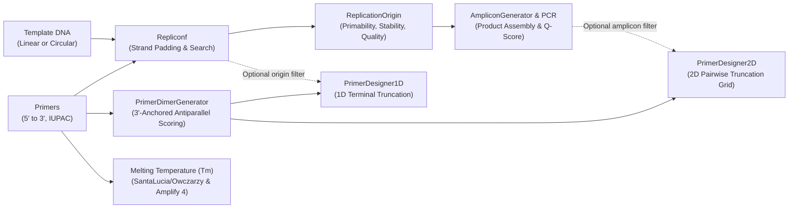
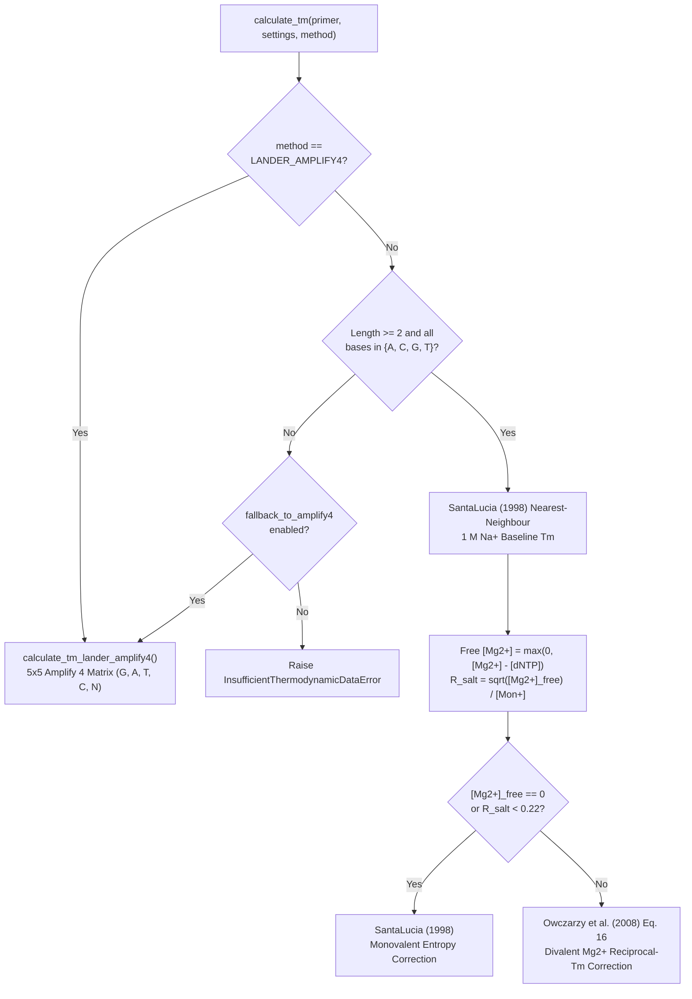

# AmplifyP Core Algorithms Guide

This document describes the mathematical models, biophysical assumptions,
scoring matrices, coordinate conventions, and algorithmic optimisations that
power **AmplifyP**'s core library (`src/amplifyp/`).

AmplifyP is a cross-platform Python re-implementation and extension of William
Engels's **Amplify 4** software [1, 2]. It preserves Amplify 4's empirically
validated heuristics for polymerase chain reaction (PCR) priming, amplicon
efficiency estimation, and primer dimer detection, while adding modern
nearest-neighbour melting temperature thermodynamics [3, 4], exact
floating-point scoring (alongside an optional Amplify 4 compatibility mode), and
1D/2D truncation-based primer design engines.

## Overview of the Computational Pipeline



| Algorithmic Component                     | Core Module                                                                                                                        | Primary Classes / Functions                                                                              |
| :---------------------------------------- | :--------------------------------------------------------------------------------------------------------------------------------- | :------------------------------------------------------------------------------------------------------- |
| Sequence representation & IUPAC codes     | [`dna.py`](../src/amplifyp/dna.py)                                                                                                 | `DNA`, `Primer`, `Nucleotides`, `DNAType`, `DNADirection`                                                |
| Directed template coordinates             | [`dir_idx.py`](../src/amplifyp/dir_idx.py)                                                                                         | `DirIdx`, `DirIdxDb`                                                                                     |
| Scoring tables & biophysical parameters   | [`settings.py`](../src/amplifyp/settings.py)                                                                                       | `BasePairWeightsTbl`, `LengthWiseWeightTbl`, `ReplicationSettings`, `PrimerDimerSettings`, `TMSettings`  |
| Replication origin evaluation             | [`origin.py`](../src/amplifyp/origin.py)                                                                                           | `ReplicationOrigin`, `Amplify4FwdOrigin`, `Amplify4RevOrigin`                                            |
| Template padding & sliding-window search  | [`repliconf.py`](../src/amplifyp/repliconf.py)                                                                                     | `Repliconf`, `OriginContextAlignment`                                                                    |
| Amplicon synthesis & `Q`-score estimation | [`amplicon.py`](../src/amplifyp/amplicon.py)                                                                                       | `Amplicon`, `AmpliconGenerator`, `AmpliconQuality`, `AmpliconRanking`, `sort_amplicons`                  |
| Reaction orchestration                    | [`pcr.py`](../src/amplifyp/pcr.py)                                                                                                 | `PCR`, `PrimerBinding`                                                                                   |
| Self-dimer & cross-dimer hybridisation    | [`dimer.py`](../src/amplifyp/dimer.py)                                                                                             | `PrimerDimer`, `PrimerDimerGenerator`, `calculate_dimer_stats`, `generate_primer_dimer`                  |
| Melting temperature (`Tm`) models         | [`melting.py`](../src/amplifyp/melting.py)                                                                                         | `calculate_tm`, `calculate_tm_santalucia_1998_owczarzy_2008`, `calculate_tm_lander_amplify4`, `TmMethod` |
| 1D & 2D truncation primer design          | [`primer_designer_1d.py`](../src/amplifyp/primer_designer_1d.py), [`primer_designer_2d.py`](../src/amplifyp/primer_designer_2d.py) | `PrimerDesigner1D`, `PrimerDesigner2D`, `PrimerDimers2D`, `FilterMetric`                                 |

______________________________________________________________________

## 1. Sequence Representation and IUPAC Degeneracy

### 1.1 Nucleotide Alphabets and Validation

AmplifyP strips standard and escaped whitespace (`\n`, `\r`, `\t`, spaces) on
construction whilst preserving character case for display (`DNA.seq`) and
caching an uppercase representation (`DNA.seq_upper`) for case-insensitive
equality, hashing, and scoring.

Valid characters are partitioned in `Nucleotides` according to their IUPAC
ambiguity class:

| Code | Class      | Represented Bases | Complement | Degeneracy Fold | Allowed in `Primer` | Allowed in `DNA` (`LINEAR` / `CIRCULAR`) |
| :--- | :--------- | :---------------- | :--------- | :-------------: | :-----------------: | :--------------------------------------: |
| `G`  | `SINGLE`   | G                 | `C`        |        1        |         Yes         |                   Yes                    |
| `A`  | `SINGLE`   | A                 | `T`        |        1        |         Yes         |                   Yes                    |
| `T`  | `SINGLE`   | T                 | `A`        |        1        |         Yes         |                   Yes                    |
| `C`  | `SINGLE`   | C                 | `G`        |        1        |         Yes         |                   Yes                    |
| `M`  | `DOUBLE`   | A or C (amino)    | `K`        |        2        |         Yes         |                   Yes                    |
| `R`  | `DOUBLE`   | A or G (purine)   | `Y`        |        2        |         Yes         |                   Yes                    |
| `W`  | `DOUBLE`   | A or T (weak)     | `W`        |        2        |         Yes         |                   Yes                    |
| `S`  | `DOUBLE`   | C or G (strong)   | `S`        |        2        |         Yes         |                   Yes                    |
| `Y`  | `DOUBLE`   | C or T (pyrim.)   | `R`        |        2        |         Yes         |                   Yes                    |
| `K`  | `DOUBLE`   | G or T (keto)     | `M`        |        2        |         Yes         |                   Yes                    |
| `V`  | `TRIPLE`   | A, C, or G        | `B`        |        3        |         Yes         |                   Yes                    |
| `H`  | `TRIPLE`   | A, C, or T        | `D`        |        3        |         Yes         |                   Yes                    |
| `D`  | `TRIPLE`   | A, G, or T        | `H`        |        3        |         Yes         |                   Yes                    |
| `B`  | `TRIPLE`   | C, G, or T        | `V`        |        3        |         Yes         |                   Yes                    |
| `N`  | `WILDCARD` | G, A, T, or C     | `N`        |        4        |         Yes         |                   Yes                    |
| `-`  | `GAP`      | Alignment gap     | `-`        |        —        |         No          |                   Yes                    |

> [!NOTE]
> Although `DNA` templates accept all 15 IUPAC nucleotide codes plus `-` on
> construction, the replication origin weight table (`Nucleotides.TEMPLATE`)
> defines non-zero columns only for `G`, `A`, `T`, `C`, and `N`. Any gap (`-`)
> or multi-base IUPAC symbol on the template evaluates to a pairwise match score
> of `0.0` during origin scanning.

### 1.2 Strand Directionality, Redundancy, and Base Composition

- **Primer Orientation**: Every `Primer` enforces `DNAType.PRIMER` and
  `DNADirection.FWD` (`5' → 3'`). Calling `.reverse()` or `.complement()` on a
  `DNA` instance inverts its `DNADirection` (`FWD ↔ REV`); calling
  `.reverse_complement()` applies both inversions and therefore preserves the
  original strand direction flag (`5' → 3'`).
- **Primer Redundancy (`Primer.redundancy_fold`)**: For a degenerate primer of
  length `L` with uppercase bases `b_0, b_1, ..., b_{L-1}`, the number of unique
  oligonucleotide species in an equimolar synthesis pool is:

```math
\text{Redundancy Fold} = \prod_{k=0}^{L-1} d(b_k), \qquad
d(b) = \begin{cases}
4 & \text{if } b = \text{N}, \\
3 & \text{if } b \in \{\text{V, H, D, B}\}, \\
2 & \text{if } b \in \{\text{M, R, W, S, Y, K}\}, \\
1 & \text{if } b \in \{\text{G, A, T, C}\}.
\end{cases}
```

- **GC and AT Ratios**: `DNA.count_cg()` counts `C`, `G`, and the strong 2-fold
  code `S` (`C/G`), whilst `DNA.count_at()` counts `A`, `T`, and the weak 2-fold
  code `W` (`A/T`). Other ambiguous codes (`M`, `R`, `Y`, `K`, `V`, `H`, `D`,
  `B`, `N`) are excluded from both numerators because their hydrogen-bond class
  is undetermined.

______________________________________________________________________

## 2. Template Padding and Coordinate Geometry

### 2.1 Biological Rationale for Boundary Padding

In experimental PCR, a primer frequently carries a `5'` sequence tail that does
not match the template—such as a restriction endonuclease site, an adapter
overhang, or a cloning homology arm—whilst its `3'` region anneals cleanly near
the end of a linear template and primes synthesis. Conversely, on a circular
template (such as a plasmid or mitochondrial genome), a primer binding site may
straddle the arbitrary coordinate origin where base `N - 1` wraps back to base
`0`.

To discover both overhanging linear binding sites and origin-crossing circular
binding sites in a single uniform scan without special-casing boundary slices,
`Repliconf` constructs two pre-processed search strings of length `N + L`, where
`N = len(template)` and `L = len(primer)`.

### 2.2 Pre-Processed Sense and Antisense Search Strands

Let `T` denote the `5' → 3'` sense strand of the template (`len(T) = N`),
`comp(·)` denote base-by-base Watson–Crick complementation (without reversal),
and `L = len(P)` denote the primer length:

1. **Linear (or Primer) Template**:
   - `template_seq[FWD] = ("-" * L) + T` — prepends `L` gap characters (`-`) to
     the `5'` end of the sense strand.
   - `template_seq[REV] = comp(T + ("-" * L))` — appends `L` gap characters to
     the `3'` end of the sense strand and takes the base-by-base complement
     (yielding the antisense strand ordered `3' → 5'` from left to right).
2. **Circular Template** (for `L > 0`):
   - `template_seq[FWD] = T[-L:] + T` — wraps the last `L` bases of `T` onto the
     `5'` end.
   - `template_seq[REV] = comp(T + T[:L])` — wraps the first `L` bases of `T`
     onto the `3'` end and takes the base-by-base complement.

Both strings have length `N + L`, yielding `(N + L) - L + 1 = N + 1` candidate
window start indices `i ∈ {0, 1, ..., N}`.

### 2.3 Unifying Forward and Reverse Search via `3' → 5'` Indexing

DNA polymerase initiates synthesis exclusively from the primer's `3'-OH`
terminus. Consequently, positional weights must always be anchored at the `3'`
end (`k = 0`) regardless of primer length `L`. AmplifyP achieves this by
reversing the primer once (`p_rev = P[::-1]`, so `p_rev[0]` is the `3'`-most
primer base and `p_rev[L - 1]` is the `5'`-most primer base) and evaluating
**sequence identity** against the two pre-processed strands:

- **Forward (`DNADirection.FWD`) Search**: A forward primer anneals to the
  antisense (`3' → 5'`) strand, meaning its `5' → 3'` sequence is **identical**
  to the local `5' → 3'` sense strand `T`. At candidate index `i`, the window
  `template_seq[FWD][i : i + L]` is read in reverse (`seq_idx = i + L - 1 - k`
  for `k = 0, ..., L - 1`), aligning the `3'` end of the sense window with
  `p_rev[0]`.
- **Reverse (`DNADirection.REV`) Search**: A reverse primer anneals to the sense
  (`5' → 3'`) strand in antiparallel `3' ← 5'` orientation, meaning its
  `3' → 5'` reversed sequence `p_rev` is **complementary** to the sense
  strand—and therefore **identical** to `template_seq[REV]`. At candidate index
  `i`, the window `template_seq[REV][i : i + L]` is read left-to-right
  (`seq_idx = i + k` for `k = 0, ..., L - 1`), aligning `template_seq[REV][i]`
  directly with `p_rev[0]`.

### 2.4 Interpretation of `DirIdx` Coordinates

Because `template_seq[FWD]` is shifted right by `L` padding characters whereas
`template_seq[REV]` starts unshifted at `T[0]`, the recorded index `i` in
`DirIdx(direction, i)` has a clean geometric meaning in 0-based unpadded
template coordinates `T[0 .. N - 1]`:

- For a **Forward origin** `start = DirIdx(FWD, i)`: the forward primer binds
  `T[i - L : i]` (with `L - i` bases overhanging past `T[0]` if `i < L`), so `i`
  is the **first template base immediately downstream (`3'`) of the forward
  primer**.
- For a **Reverse origin** `end = DirIdx(REV, j)`: the reverse primer binds
  `T[j : j + L]` (with `(j + L) - N` bases of its `5'` tail overhanging past
  `T[N - 1]` if `j > N - L`), so `j` is the **template position paired with the
  reverse primer's `3'`-most base**—i.e. one past the last internal template
  base upstream of the reverse primer.

Therefore, for any non-wrapping amplicon between `start = DirIdx(FWD, i)` and
`end = DirIdx(REV, j)` with `i < j`, the internal amplified template sequence
between the two primers is simply the Python slice **`T[i : j]`**!

```text
Example: Linear template T = "ACCTCCTAGGAGGTTT" (N = 16), primer P = "CCT" (L = 3)

0-based T index:        0 1 2 3 4 5 6 7 8 9 10 11 12 13 14 15
Sense T (5'->3'):       A C C T C C T A G G  A  G  G  T  T  T

template_seq[FWD]:  - - - A C C T C C T A G  G  A  G  G  T  T  T
FWD index:          0 1 2 3 4 5 6 7 ...
                        [C C T]                 -> FWD hit at i = 4 (binds T[1:4])
                              [C C T]           -> FWD hit at i = 7 (binds T[4:7])

template_seq[REV]:        T G G A G G A T C C  T  C  C  A  A  A  -  -  -
REV index:                0 1 2 3 4 5 6 7 8 9 10 11 12 13 14 15 16 17 18
                                        [C C  T]          -> REV hit at j = 7  (3'<-5' binds T[7:10])
                                              [C  C  T]   -> REV hit at j = 10 (3'<-5' binds T[10:13])

Amplicon (i = 4, j = 7):  P ("CCT") + T[4:7] ("CCT") + rev_comp(P) ("AGG") = "CCTCCTAGG" (9 bp)
```

______________________________________________________________________

## 3. Replication Origin Scoring

At each candidate position, `ReplicationOrigin` evaluates a primer sequence
`p_0, p_1, ..., p_{L-1}` (indexed `3' → 5'`) against an equal-length target
slice `t_0, t_1, ..., t_{L-1}` (already oriented to match `3' → 5'` sense
identity).

### 3.1 Pairwise Nucleotide Match Matrix (`DEFAULT_BASE_PAIR_WEIGHTS`)

Base-pair compatibility `S(p, t)` is defined by a `15 × 5` matrix mapping primer
bases (rows) against template bases `G`, `A`, `T`, `C`, `N` (columns), with gap
`-` (and any unrecognised template byte) assigned `0`:

| Primer Base (`p`) | Possible Bases | `t = G` | `t = A` | `t = T` | `t = C` | `t = N` | `t = -` | Row Max `M(p)` |
| :---------------: | :------------- | ------: | ------: | ------: | ------: | ------: | ------: | -------------: |
|        `G`        | G              |     100 |       0 |       0 |       0 |      30 |       0 |            100 |
|        `A`        | A              |       0 |     100 |       0 |       0 |      30 |       0 |            100 |
|        `T`        | T              |       0 |       0 |     100 |       0 |      30 |       0 |            100 |
|        `C`        | C              |       0 |       0 |       0 |     100 |      30 |       0 |            100 |
|        `M`        | A, C           |       0 |      70 |       0 |      70 |      30 |       0 |             70 |
|        `R`        | A, G           |      70 |      70 |       0 |       0 |      30 |       0 |             70 |
|        `W`        | A, T           |       0 |      70 |      70 |       0 |      30 |       0 |             70 |
|        `S`        | C, G           |      70 |       0 |       0 |      70 |      30 |       0 |             70 |
|        `Y`        | C, T           |       0 |       0 |      70 |      70 |      30 |       0 |             70 |
|        `K`        | G, T           |      70 |       0 |      70 |       0 |      30 |       0 |             70 |
|        `V`        | A, C, G        |      50 |      50 |       0 |      50 |      30 |       0 |             50 |
|        `H`        | A, C, T        |       0 |      50 |      50 |      50 |      30 |       0 |             50 |
|        `D`        | A, G, T        |      50 |      50 |      50 |       0 |      30 |       0 |             50 |
|        `B`        | C, G, T        |      50 |       0 |      50 |      50 |      30 |       0 |             50 |
|        `N`        | G, A, T, C     |      30 |      30 |      30 |      30 |      30 |       0 |             30 |

Notice the role of the row maximum `M(p) = max_b S(p, b)`:

- When a degenerate primer base matches one of its intended nucleotides on the
  template (for example, `M` against `A`), `S(M, A) = 70` equals `M(M) = 70`, so
  the site can still achieve a `1.0` normalised score—meaning a degenerate
  primer pool is **not** penalised relative to a non-degenerate primer when an
  individual molecule in the pool matches the target.
- Conversely, an ambiguous base carries less weight (`70`, `50`, or `30` vs
  `100`) in the weighted sum relative to unambiguous bases within the same
  primer, so a mismatch at an unambiguous `3'` base penalises the score more
  sharply than a mismatch at an `N` position.
- When the **template** contains an unknown base `N` paired against a standard
  primer base (e.g. `G`), `S(G, N) = 30 < M(G) = 100`, appropriately discounting
  the match due to template sequence uncertainty.

### 3.2 Primability (`primability`)

**Primability** (`P ∈ [0, 1]`) models the ability of DNA polymerase to initiate
strand extension from the primer's `3'` end. It is a position-weighted ratio of
achieved pairwise match scores to the maximum attainable score for that primer:

```math
P = \frac{\sum_{k=0}^{L-1} m_k \cdot S(p_k, t_k)}{\sum_{k=0}^{L-1} m_k \cdot M(p_k)}
```

(returning `0.0` if the denominator is zero), where `k = 0` is the `3'`-most
base and `m_k` is looked up in `DEFAULT_MATCH_WEIGHTS` (`LengthWiseWeightTbl`):

| `3'` Offset `k`     |   0 |   1 |   2 |   3 |   4 |   5 |   6 |   7 |   8 |   9 |  10 |  11 |  12 |  13 |  14 | `≥ 15` (Default) |
| :------------------ | --: | --: | --: | --: | --: | --: | --: | --: | --: | --: | --: | --: | --: | --: | --: | ---------------: |
| `1`-Based `3'` Pos. |   1 |   2 |   3 |   4 |   5 |   6 |   7 |   8 |   9 |  10 |  11 |  12 |  13 |  14 |  15 |           `≥ 16` |
| Match Weight `m_k`  |  30 |  20 |  10 |  10 |   9 |   9 |   8 |   7 |   6 |   5 |   5 |   4 |   3 |   2 |   1 |                1 |

Because `m_0 = 30` and `m_1 = 20`, the terminal two bases at the `3'` end carry
as much weight (`50`) as fifty bases in the `5'` tail (`k ≥ 14`), capturing the
severe experimental sensitivity of Taq and proofreading polymerases to `3'`
terminal mismatches.

### 3.3 Duplex Stability (`stability`)

**Stability** (`Z ∈ [0, 1]`) models the overall structural and co-operative
base-stacking strength of the primer–template duplex. Rather than weighting
positions by distance from the `3'` end, it partitions all matching positions
(`S(p_k, t_k) > 0`) into maximal contiguous **runs** `R_1, R_2, ..., R_G`
separated by mismatches or gaps (`S(p_k, t_k) == 0`).

Let `ℓ_g = |R_g| ≥ 1` denote the length of contiguous matching run `g`. Each run
multiplies its internal base-pair score sum by a run-length weight `r_{ℓ_g - 1}`
from `DEFAULT_RUN_WEIGHTS`, normalised against a single unbroken run of length
`L`:

```math
Z = \frac{\sum_{g=1}^{G} r_{\ell_g - 1} \sum_{k \in R_g} S(p_k, t_k)}{r_{L - 1} \sum_{k=0}^{L-1} M(p_k)}
```

| Contiguous Run Length `ℓ` | 0-Based Key `ℓ - 1` | Run Weight `r_{ℓ - 1}` |
| :-----------------------: | :-----------------: | ---------------------: |
|             1             |          0          |                    100 |
|             2             |          1          |                    150 |
|             3             |          2          |                    175 |
|             4             |          3          |                    182 |
|      `≥ 5` (Default)      |        `≥ 4`        |                    186 |

Isolated single-base matches (`r_0 = 100`) contribute barely half as much per
base (`100 / 186 ≈ 53.8%`) as contiguous duplex stretches of five or more base
pairs (`r_4 = 186`), reflecting the thermodynamic requirement for uninterrupted
nearest-neighbour base stacking.

> [!IMPORTANT]
> **Amplify 4 Source vs Documentation Note**: The stability equation above is a
> direct port of Amplify 4's Swift implementation, which differs from the
> simplified equation described in the original Amplify 4 `README`. Preserving
> the exact run-group accumulation from Amplify 4's source code guarantees
> identical origin predictions on Amplify 4 benchmark reactions.

### 3.4 Cutoff Filtering, Origin Quality, and Amplify 4 Compatibility Mode

During `Repliconf.search()`, a candidate position is accepted as a valid
replication origin if and only if it **strictly** exceeds both configured
cutoffs:

```math
P > c_P \quad \text{and} \quad Z > c_Z
```

where the defaults are `c_P = 0.80` (`DEFAULT_PRIMABILITY_CUTOFF`) and
`c_Z = 0.40` (`DEFAULT_STABILITY_CUTOFF`).

Once accepted, primability and stability are combined into a single **origin
quality** score `q` rescaled against the cutoff sum `C = c_P + c_Z`:

- **Standard Floating-Point Mode (`amplify4_compatibility_mode = False`,
  default)**:

```math
q = \begin{cases}
\dfrac{P + Z - (c_P + c_Z)}{2 - (c_P + c_Z)} & \text{if } c_P + c_Z \neq 2, \\[8pt]
0.0 & \text{if } c_P + c_Z = 2.
\end{cases}
```

- **Amplify 4 Compatibility Mode (`amplify4_compatibility_mode = True`)**:
  Amplify 4 stored primability and stability as integer percentages (`0`–`100`)
  before computing origin quality. When compatibility mode is enabled, AmplifyP
  truncates both scores to two decimal places prior to combining them:

```math
P_{\text{amp4}} = \frac{\text{trunc}(100 P)}{100}, \qquad
Z_{\text{amp4}} = \frac{\text{trunc}(100 Z)}{100}, \qquad
q_{\text{amp4}} = \frac{P_{\text{amp4}} + Z_{\text{amp4}} - (c_P + c_Z)}{2 - (c_P + c_Z)}
```

For any origin passing the cutoffs (when `c_P + c_Z < 2`), `q ∈ (0, 1]`, with
`q = 1.0` achieved only when `P = 1.0` and `Z = 1.0`. If `ReplicationOrigin` is
evaluated directly on a sub-cutoff site, `q` can be zero or negative.

For visual alignment rendering (`ReplicationOrigin.binding_strength_str`), let
`S_max = max_{p, t} S(p, t)` (`100` under default weights). Each aligned pair
`(p_k, t_k)` renders as:

- `|` if `S(p_k, t_k) ≥ S_max` (exact canonical base match),
- `:` if `0 < S(p_k, t_k) < S_max` (degenerate or `N` match),
- `' '` (space) if `S(p_k, t_k) == 0` (mismatch or gap).

### 3.5 Sliding-Window Search Optimisations

Because `Repliconf.search()` executes `2(N + 1)` window evaluations of length
`L`—and is invoked thousands of times during 1D/2D primer truncation sweeps—it
includes five key optimisations:

1. **Precomputed ASCII Lookup Tables (`_get_scoring_tables`)**: An
   `@lru_cache(maxsize=128)` helper keyed on the reversed primer sequence and an
   immutable content snapshot of the replication settings (the scoring table
   `cache_key()` values plus `primability_cutoff`) precomputes both denominators
   (`prim_denom`, `stab_denom`) and a tuple of `L` 256-entry lookup tables
   `score_lookup[k][ascii_code] = (m_k * S(p_k, b), S(p_k, b))` populated for
   both uppercase and lowercase ASCII codes of `Nucleotides.TEMPLATE`. Keying
   the settings by content rather than object identity lets separately
   constructed but equal settings share cached tables.
2. **Zero-Allocation Inner Byte Scan**: Each strand `template_seq[direction]` is
   encoded once to an ASCII `bytes` buffer (`seq.encode("ascii")`), allowing the
   inner loop to index `k_lookup[seq_bytes[seq_idx]]` directly by integer byte
   value with `step = -1` (`FWD`) or `step = +1` (`REV`), avoiding per-window
   string slicing, reversal allocations, case conversion, and dictionary
   hashing.
3. **First-Position Pre-Filter and Remaining-Weight Pruning**: The cached tables
   also derive a 256-entry byte mask (`k0_mask`) of template bases whose
   first-position (3') primability contribution `m_0 · S(p_0, b)` plus the
   maximum obtainable remainder can still reach the primability requirement
   `prim_req = primability_cutoff · prim_denom`. Candidate positions whose first
   template base is masked out are skipped without running the full `L`-step
   inner loop, and each window's accumulation aborts as soon as
   `prim_num + rem_max[k] < prim_req` guarantees the cutoff cannot be met. The
   mask is only applied when at most two of `A`, `C`, `G`, `T` are "good" at the
   first position (so filtering stays selective), and a strand is skipped
   entirely when no base can pass.
4. **Inline Score Caching on `DirIdx`**: Accepted origins store their computed
   `primability` and `stability` directly inside frozen `@dataclass(slots=True)`
   `DirIdx` instances (with `compare=False` so coordinate equality and hashing
   remain purely positional), avoiding redundant rescoring during amplicon
   generation.
5. **Chunked Cooperative Execution (`iter_search`)**: The scan is exposed as
   `iter_search(chunk_size=4096)`, which evaluates at most `chunk_size`
   candidate positions per strand before yielding, so single-threaded callers
   (such as a Flet event loop running in WebAssembly) can flush progress and
   process cancellation requests between chunks. `search()` simply consumes the
   iterator to completion.

______________________________________________________________________

## 4. Amplicon Prediction and Quality Scoring

### 4.1 Single-Primer and Multiplex Origin Pairing

`PCR` creates one `Repliconf` per added primer (enforcing unique primer names
and case-insensitive sequences) and registers all configurations with
`AmpliconGenerator`. Because every `Repliconf` searches **both** `FWD` and `REV`
strands, `AmpliconGenerator.get_amplicons()` evaluates the full Cartesian
product of all discovered forward origins `(fwd_conf, start)` and all discovered
reverse origins `(rev_conf, end)` across the entire primer pool. This naturally
predicts:

- Standard two-primer amplicons (`fwd_conf != rev_conf`),
- Single-primer amplicons (`fwd_conf == rev_conf`) where inverted-repeat sites
  allow one oligonucleotide to prime both strands, and
- Off-target or multiplex products arising from secondary binding sites.

### 4.2 Linear vs Circular Product Assembly

Given `start = DirIdx(FWD, i)` and `end = DirIdx(REV, j)` on template `T` of
length `N`:

1. **Direct (Non-Wrapping) Product (`i < j`, Linear or Circular Template)**:
   - Valid on both `DNAType.LINEAR` and `DNAType.CIRCULAR`.
   - Product sequence: `P_fwd + T[i : j] + rev_comp(P_rev)`, marked
     `circular = False`.
2. **Origin-Wrapping Product (`i ≥ j` on `DNAType.CIRCULAR`)**:
   - Valid only when `T.type == DNAType.CIRCULAR` (skipped on linear DNA because
     divergent `3'` ends cannot amplify exponentially across free ends).
   - Product sequence wraps across coordinate `0`:
     `P_fwd + T[i:] + T[:j] + rev_comp(P_rev)`, marked `circular = True`.
   - Note that when `i == j` on a circular template, synthesis traverses the
     entire plasmid circumference (`T[i:] + T[:i]`, internal length `N`).

> [!NOTE]
> The synthesised product always incorporates the exact primer sequences `P_fwd`
> and `rev_comp(P_rev)` at its `5'` and `3'` ends rather than the underlying
> template bases at the binding sites. This matches experimental PCR, where
> primer mismatches and `5'` overhang tails become fixed into exponentially
> amplified daughter strands.

### 4.3 Amplicon Quality Score (`Q`), Tiers, and Ranking

Let `L_int` denote the inter-primer template length
(`len(product) - len(P_fwd) - len(P_rev)`), and let `q_fwd` and `q_rev` denote
the `ReplicationOrigin.quality` scores at `start` and `end`. AmplifyP defines
the amplicon quality score `Q` (`q_score`) following Amplify 4:

```math
Q = \begin{cases}
\dfrac{L_{\text{int}}}{(q_{\text{fwd}} \cdot q_{\text{rev}})^2} & \text{if } q_{\text{fwd}} \cdot q_{\text{rev}} \neq 0, \\[8pt]
+\infty & \text{if } q_{\text{fwd}} \cdot q_{\text{rev}} = 0.
\end{cases}
```

Key properties of `Q`:

- **Lower `Q` indicates higher predicted amplification efficiency.**
- When both primers match perfectly (`q_fwd = q_rev = 1.0`), `Q = L_int` (the
  internal fragment length in base pairs).
- Suboptimal priming (`q < 1`) inflates `Q` via an inverse-square penalty
  `(q_fwd · q_rev)^{-2}`, modelling how poor annealing efficiency compounds
  across thermal cycles, whilst longer fragments proportionally increase `Q` due
  to polymerase extension time and processivity constraints.

`Amplicon` classifies `Q` into five qualitative tiers (`AmpliconQuality`):

| `Q` Score Interval | Tier (`AmpliconQuality`) | Verbose Gel Interpretation                                         |
| :----------------- | :----------------------- | :----------------------------------------------------------------- |
| `Q < 300`          | `good`                   | `good amplification`                                               |
| `300 ≤ Q < 700`    | `okay`                   | `okay amplification`                                               |
| `700 ≤ Q < 1500`   | `moderate`               | `moderate amplification`                                           |
| `1500 ≤ Q < 4000`  | `weak`                   | `weak amplification — might be visible on an agarose gel`          |
| `Q ≥ 4000`         | `very weak`              | `very weak amplification — probably not visible on an agarose gel` |

When **Relative `Q`** display is enabled, `min_positive_q_score(amplicons)`
finds `Q_min = min { Q > 0 : Q finite }`; if such a `Q_min` exists, it computes
`Q_eff = (Q / Q_min) · 100` (normalising the best product in the reaction to
`100.000`). Otherwise (when **Relative `Q`** is disabled or no positive finite
`Q` exists), `Q_eff = Q`. Qualitative tier labels evaluate `Q_eff` against the
standard `Q` thresholds above, and amplicon bar heights in the PCR diagram scale
smoothly over `[1.0, 8.0]` px via an exponential decay curve:

```math
h(Q_{\text{eff}}) = \begin{cases}
8.0 & \text{if } Q_{\text{eff}} \le 0, \\[4pt]
1.0 + 7.0 \exp\!\left(-\dfrac{Q_{\text{eff}}}{800}\right) & \text{if } 0 < Q_{\text{eff}} < +\infty, \\[8pt]
1.0 & \text{if } Q_{\text{eff}} \text{ is non-finite}.
\end{cases}
```

Predicted amplicons can be ordered via `sort_amplicons` under three
lexicographic `AmpliconRanking` modes:

1. `Position, then length` (default): `(start.index, len(product), q_score)`
2. `Quality score`: `(q_score, start.index, len(product))`
3. `Position, then quality`: `(start.index, q_score, len(product))`

______________________________________________________________________

## 5. Primer Dimer Hybridisation Analysis

### 5.1 Biological Rationale: `3'`-Extendable Dimers

Two primers in solution can transiently hybridise either to another copy of the
same oligonucleotide (**self-dimer**) or to a different primer
(**cross-dimer**). However, a transient hybrid only sequesters polymerase and
generates competing artefact amplicons when at least one primer's **`3'-OH`
terminus** is base-paired against the partner strand so DNA polymerase can
extend it (`5' → 3'`). Alignments where only the `5'` regions overlap—leaving
unannealed `3'` single-stranded tails on both strands—cannot be extended by
polymerase.

Accordingly, AmplifyP (following Amplify 4) evaluates only **`3'`-anchored
antiparallel alignments**.

### 5.2 `3'`-Anchored Sliding Alignment (`calculate_dimer_stats`)

Given uppercase primer sequences `s_1` of length `n_1` and `s_2` of length
`n_2`, AmplifyP slides the `3'` terminus of `s_1` (`s_1[n_1 - 1]`, oriented
`3' → 5'`) across every starting index `p ∈ {0, 1, ..., n_2 - 1}` of `s_2`
(oriented `5' → 3'`):

```text
s2 (5'->3'):   5'- G T G G G T A T C A C A A A T T T G G G -3'   (n2 = 20)
                           |   | | | | | | | |   |               (p = 8, overlap = 12)
s1 (3'->5'):           3'- G G G T T T A A A C A C T A T G G G T G -5'
```

At alignment start position `p` on `s_2`, the antiparallel overlap length is:

```math
\omega(p) = \min(n_1,\, n_2 - p)
```

and the dimer quality score `D(p)` sums pairwise interaction weights `W` across
the `ω(p)` overlapping base pairs:

```math
D(p) = \sum_{u=0}^{\omega(p) - 1} W\bigl(s_1[n_1 - 1 - u],\, s_2[p + u]\bigr)
```

The optimal alignment selects `p*` maximising `D(p)`:

- **Tie-Breaking towards `3'`–`3'` Overlap**: The scan updates `best_pos = p`
  whenever `D(p) ≥ best_quality`. Because `p` increases from `0` (`5'` end of
  `s_2`) to `n_2 - 1` (`3'` end of `s_2`), ties favour larger `p`—the shorter,
  more `3'`-proximal overlap where **both** primers' `3'` ends lie near the
  duplex boundary and can prime bilateral extension.
- **Reordering and Symmetry (`generate_primer_dimer`)**:
  - When `reorder = True` (default in `PrimerDimerGenerator` and
    `PrimerDesigner1D`), the shorter primer is placed as `s_1` (`n_1 ≤ n_2`) so
    every position of `s_2` is tested against `s_1`'s `3'` end. When
    `n_1 == n_2` and `s_1 != s_2`, **both** `(s_1, s_2)` and `(s_2, s_1)` are
    evaluated and the strictly higher-scoring orientation is retained, making
    `generate_primer_dimer(p1, p2)` symmetric in primer argument order.
  - When `reorder = False` (used in `PrimerDesigner2D`), `p1`'s `3'` end is
    strictly aligned against `p2`, distinguishing `Fwd 3' → Rev` extension from
    `Rev 3' → Fwd` extension.

### 5.3 Pairwise Primer Dimer Weight Matrix (`DEFAULT_PRIMER_DIMER_WEIGHTS`)

Unlike `DEFAULT_BASE_PAIR_WEIGHTS` (which scores sense-strand identity and
assigns `0` to mismatches), `DEFAULT_PRIMER_DIMER_WEIGHTS` is a symmetric
`15 × 15` matrix that directly scores **antiparallel Watson–Crick
complementarity** between two `5' → 3'` primer bases, balancing hydrogen-bond
stabilisation against steric mismatch penalties:

- Canonical `G:C` / `C:G` pair (3 hydrogen bonds): **`+30`**
- Canonical `A:T` / `T:A` pair (2 hydrogen bonds): **`+20`**
- Canonical non-complementary mismatch (`G:G`, `G:A`, `G:T`, `A:A`, `A:C`,
  `T:T`, `T:C`, `C:C`): **`-20`**
- IUPAC degenerate bases: rounded expected values over all equiprobable
  canonical base pairs represented by the two symbols (for example, `G` vs `Y`
  `{C, T}` averages `+30` and `-20` to **`+5`**; `A` vs `W` `{A, T}` averages
  `+20` and `-20` to **`0`**; `N` vs `N` averages `(60 + 40 - 240) / 16 = -8.75`
  to **`-9`**).

| `W` | `G` | `A` | `T` | `C` | `M` | `R` | `W` | `S` | `Y` | `K` | `V` | `H` | `D` | `B` | `N` |
| :-: | --: | --: | --: | --: | --: | --: | --: | --: | --: | --: | --: | --: | --: | --: | --: |
| `G` | -20 | -20 | -20 |  30 |   5 | -20 | -20 |   5 |   5 | -20 |  -3 |  -3 | -20 |  -3 |  -8 |
| `A` | -20 | -20 |  20 | -20 | -20 | -20 |   0 | -20 |   0 |   0 | -20 |  -7 |  -7 |  -7 | -10 |
| `T` | -20 |  20 | -20 | -20 |   0 |   0 |   0 | -20 | -20 | -20 |  -7 |  -7 |  -7 | -20 | -10 |
| `C` |  30 | -20 | -20 | -20 | -20 |   5 | -20 |   5 | -20 |   5 |  -3 | -20 |  -3 |  -3 |  -8 |
| `M` |   5 | -20 |   0 | -20 | -20 |  -8 | -10 |  -8 | -10 |   3 | -12 | -13 |  -5 |  -5 |  -9 |
| `R` | -20 | -20 |   0 |   5 |  -8 | -20 | -10 |  -8 |   3 | -10 | -12 |  -5 | -13 |  -5 |  -9 |
| `W` | -20 |   0 |   0 | -20 | -10 | -10 |   0 | -20 | -10 | -10 | -13 |  -7 |  -7 | -13 | -10 |
| `S` |   5 | -20 | -20 |   5 |  -8 |  -8 | -20 |   5 |  -8 |  -8 |  -3 | -12 | -12 |  -3 |  -8 |
| `Y` |   5 |   0 | -20 | -20 | -10 |   3 | -10 |  -8 | -20 |  -8 |  -5 | -13 |  -5 | -12 |  -9 |
| `K` | -20 |   0 | -20 |   5 |   3 | -10 | -10 |  -8 |  -8 | -20 |  -5 |  -5 | -13 | -12 |  -9 |
| `V` |  -3 | -20 |  -7 |  -3 | -12 | -12 | -13 |  -3 |  -5 |  -5 |  -9 | -10 | -10 |  -4 |  -8 |
| `H` |  -3 |  -7 |  -7 | -20 | -13 |  -5 |  -7 | -12 | -13 |  -5 | -10 | -11 |  -6 | -10 |  -9 |
| `D` | -20 |  -7 |  -7 |  -3 |  -5 | -13 |  -7 | -12 |  -5 | -13 | -10 |  -6 | -11 | -10 |  -9 |
| `B` |  -3 |  -7 | -20 |  -3 |  -5 |  -5 | -13 |  -3 | -12 | -12 |  -4 | -10 | -10 |  -9 |  -8 |
| `N` |  -8 | -10 | -10 |  -8 |  -9 |  -9 | -10 |  -8 |  -9 |  -9 |  -8 |  -9 |  -9 |  -8 |  -9 |

Visual bond symbols (`PrimerDimer.binding_strength_str`) classify each aligned
pair `(c_1, c_2)` against `symbol_threshold` (default `10.0`):

- `|` if `W(c_1, c_2) ≥ 10.0` (canonical `G:C` or `A:T` Watson–Crick pair),
- `:` if `0.0 ≤ W(c_1, c_2) < 10.0` (neutral or weak ambiguous pairing),
- `' '` (space) if `W(c_1, c_2) < 0.0` (repulsive mismatch).

### 5.4 Batch Evaluation, Memoisation, and Filtering

For `M` configured primers, `PrimerDimerGenerator.analyse_primers()` iterates
over all `M(M + 1) / 2` unordered pairs with replacement
(`itertools.combinations_with_replacement`), covering every self-dimer and
cross-dimer combination:

1. **Sequence-Pair Memoisation**: Results
   `(best_quality, best_pos, overlap_len)` are memoised by ordered uppercase
   sequence tuple `(s_1, s_2)`.
2. **Strict Threshold Filtering**: A dimer is reported if and only if
   `best_quality > threshold` (default `60.0`) **and**
   `overlap_len > min_overlap` (default `3`, requiring at least `4` overlapping
   base pairs). Notice that both inequalities are **strict** (`>`): a dimer with
   `quality == 60.0` or `overlap == 3` is excluded.
3. **Risk Ranking**: Retained dimers are sorted in descending order of
   `quality`.

______________________________________________________________________

## 6. Primer Melting Temperature (`Tm`) Models

AmplifyP provides two oligonucleotide melting temperature models in
`amplifyp.melting`, coordinated by `calculate_tm()`:



### 6.1 SantaLucia (1998) + Owczarzy et al. (2008) Model (Default)

`calculate_tm_santalucia_1998_owczarzy_2008()` computes duplex melting
temperature using unified DNA nearest-neighbour parameters [3] combined with
monovalent and divalent cation corrections [4]. For sequences of length `N < 2`,
it returns `0.0`; if any base lies outside `{A, C, G, T}`, it raises
`InsufficientThermodynamicDataError`.

#### Step 1: Nearest-Neighbour Enthalpy (`ΔH°`) and Entropy (`ΔS°`) at `1 M Na⁺`

Total standard-state enthalpy `ΔH°` (in `cal/mol`) and entropy `ΔS°` (in
`cal/(K·mol)`) are accumulated from terminal initiation terms, an optional
palindromic symmetry penalty, and the `N - 1` adjacent `5' → 3'` dinucleotide
steps:

1. **Terminal Initiation Corrections** (applied independently to the `5'` base
   `s_0` and `3'` base `s_{N-1}`):
   - Terminal `G` or `C`: `+100 cal/mol` (`+0.1 kcal/mol`) to `ΔH°` and
     `-2.8 cal/(K·mol)` to `ΔS°`.
   - Terminal `A` or `T`: `+2300 cal/mol` (`+2.3 kcal/mol`) to `ΔH°` and
     `+4.1 cal/(K·mol)` to `ΔS°`.
2. **Self-Complementarity Symmetry Correction**:
   - If the primer equals its own reverse complement (`S == rev_comp(S)`),
     `-1.4 cal/(K·mol)` is added to `ΔS°` and the strand concentration symmetry
     divisor is set to `k_sym = 1`; otherwise `k_sym = 4` (standard two-state
     heteroduplex assumption).
3. **Nearest-Neighbour Dinucleotide Steps (`NN_THERMO_DATA`, SantaLucia 1998)**:

| `5'→3'` Step | Complementary Step | `ΔH°` (`cal/mol`) | `ΔS°` (`cal/(K·mol)`) |
| :----------: | :----------------: | ----------------: | --------------------: |
| `AA` / `TT`  |    `TT` / `AA`     |             -7900 |                 -22.2 |
|     `AT`     |        `AT`        |             -7200 |                 -20.4 |
|     `TA`     |        `TA`        |             -7200 |                 -21.3 |
| `CA` / `TG`  |    `TG` / `CA`     |             -8500 |                 -22.7 |
| `GT` / `AC`  |    `AC` / `GT`     |             -8400 |                 -22.4 |
| `CT` / `AG`  |    `AG` / `CT`     |             -7800 |                 -21.0 |
| `GA` / `TC`  |    `TC` / `GA`     |             -8200 |                 -22.2 |
|     `CG`     |        `CG`        |            -10600 |                 -27.2 |
|     `GC`     |        `GC`        |             -9800 |                 -24.4 |
| `GG` / `CC`  |    `CC` / `GG`     |             -8000 |                 -19.9 |

#### Step 2: Baseline `1 M Na⁺` Melting Temperature

With gas constant `R = 1.987 cal/(K·mol)` and total oligonucleotide strand
concentration `C_T = dna_conc × 10⁻⁹ M` (default `50 nM`; non-positive inputs
fall back to `50 nM`), the baseline melting temperature in Kelvin at `1 M Na⁺`
is:

```math
T_{m,\text{1M}} = \frac{\Delta H^\circ}{\Delta S^\circ + R \ln(C_T / k_{\text{sym}})}
```

#### Step 3: Free Magnesium Chelation and Cation Regime Selection

Deoxynucleotide triphosphates (`dNTP`s) chelate divalent magnesium ions (`Mg²⁺`)
in an approximately `1:1` stoichiometric complex. AmplifyP converts millimolar
settings into molar concentrations (clamping negative inputs to `0`) and deducts
`[dNTP]` from total `[Mg²⁺]` to obtain free magnesium:

```math
[\text{Mon}^+] = \max(0,\, c_{\text{mono}}) \times 10^{-3}, \qquad
[\text{Mg}^{2+}]_{\text{free}} = \max\bigl(0,\, \max(0, c_{\text{div}}) - \max(0, c_{\text{dNTP}})\bigr) \times 10^{-3}
```

(defaults: `c_mono = 50.0 mM`, `c_div = 1.5 mM`, `c_dNTP = 0.0 mM`). Next, the
Owczarzy et al. (2008) cation ratio `R_salt` determines whether monovalent or
divalent counterions dominate duplex stabilisation:

```math
R_{\text{salt}} = \begin{cases}
999.0 & \text{if } [\text{Mon}^+] \approx 0, \\[6pt]
\dfrac{\sqrt{[\text{Mg}^{2+}]_{\text{free}}}}{[\text{Mon}^+]} & \text{otherwise.}
\end{cases}
```

#### Step 4: Salt-Corrected Melting Temperature

- **Monovalent-Only or Monovalent-Dominant Regime (`[Mg²⁺]_free ≈ 0` or
  `R_salt < 0.22`)**: Applies the SantaLucia (1998) phosphate-backbone entropy
  correction (for `[Mon⁺] > 0`; if both `[Mg²⁺]_free ≈ 0` and `[Mon⁺] == 0`,
  `T_m = T_{m,1M}`):

```math
\Delta S_{\text{corr}} = \Delta S^\circ + 0.368 (N - 1) \ln[\text{Mon}^+], \qquad
T_m (\text{K}) = \frac{\Delta H^\circ}{\Delta S_{\text{corr}} + R \ln(C_T / k_{\text{sym}})}
```

- **Mixed or Magnesium-Dominant Regime (`[Mg²⁺]_free > 0` and
  `R_salt ≥ 0.22`)**: Applies Owczarzy et al. (2008) Equation 16 to the
  reciprocal melting temperature using GC fraction `f_GC = primer.ratio_cg()`:

```math
\frac{1}{T_m (\text{K})} = \frac{1}{T_{m,\text{1M}}}
+ a + b \ln[\text{Mg}^{2+}]_{\text{free}}
+ f_{\text{GC}}\bigl(c + d \ln[\text{Mg}^{2+}]_{\text{free}}\bigr)
+ \frac{1}{2(N - 1)}\Bigl(e + f \ln[\text{Mg}^{2+}]_{\text{free}} + g\bigl(\ln[\text{Mg}^{2+}]_{\text{free}}\bigr)^2\Bigr)
```

with empirical constants `a = 3.92 × 10⁻⁵`, `b = -9.11 × 10⁻⁶`,
`c = 6.26 × 10⁻⁵`, `d = 1.42 × 10⁻⁵`, `e = -4.82 × 10⁻⁴`, `f = 5.25 × 10⁻⁴`, and
`g = 8.31 × 10⁻⁵` `K⁻¹`. (AmplifyP uses Equation 16 directly across the entire
`R_salt ≥ 0.22` domain rather than switching to the competitive-binding
interpolation coefficients for `0.22 ≤ R_salt < 6.0`.)

Finally, temperature is converted to degrees Celsius:
`T_m (°C) = T_m (K) - 273.15`.

### 6.2 Legacy Lander / Amplify 4 Model

`calculate_tm_lander_amplify4()` is a faithful port of `Primer.calcTm` from
Amplify 4 (derived from Breslauer et al., 1986 [5] parameters as used in early
Primer / Amplify software). It returns `0.0` for empty sequences (`N < 1`).

For each adjacent `5' → 3'` dinucleotide `(x, y) = (s_i, s_{i+1})`, it looks up
**`table[y, x]`** (row = next base `y`, column = current base `x`) in two
customisable `5 × 5` matrices defined over `G`, `A`, `T`, `C`, `N`:

| `DEFAULT_AMPLIFY4_TM_ENTHALPY` (`[y, x]`) | `x = G` | `x = A` | `x = T` | `x = C` | `x = N` |
| :---------------------------------------: | ------: | ------: | ------: | ------: | ------: |
|                  `y = G`                  |     110 |      78 |      58 |     119 |      94 |
|                  `y = A`                  |      56 |      91 |      60 |      58 |      81 |
|                  `y = T`                  |      65 |      86 |      91 |      78 |      78 |
|                  `y = C`                  |     111 |      65 |      56 |     110 |     105 |
|                  `y = N`                  |      65 |      86 |      60 |      78 |      78 |

| `DEFAULT_AMPLIFY4_TM_ENTROPY` (`[y, x]`) | `x = G` | `x = A` | `x = T` | `x = C` | `x = N` |
| :--------------------------------------: | ------: | ------: | ------: | ------: | ------: |
|                 `y = G`                  |     266 |     208 |     129 |     278 |     220 |
|                 `y = A`                  |     135 |     240 |     169 |     129 |     168 |
|                 `y = T`                  |     173 |     239 |     240 |     208 |     215 |
|                 `y = C`                  |     267 |     173 |     135 |     266 |     210 |
|                 `y = N`                  |     173 |     239 |     169 |     208 |     215 |

With initiation entropy offset `108.0`, scaling factor `-0.1`, strand
concentration `c_dna` in `nM` (default `50.0`), and monovalent salt `c_mono` in
`mM` (default `50.0`):

```math
\Delta H_{\text{amp4}} = -0.1 \sum_{i=0}^{N-2} H_{\text{tbl}}(s_{i+1}, s_i), \qquad
\Delta S_{\text{amp4}} = -0.1 \left(108.0 + \sum_{i=0}^{N-2} S_{\text{tbl}}(s_{i+1}, s_i)\right)
```

```math
T_m (^\circ\text{C}) = \frac{1000 \cdot \Delta H_{\text{amp4}}}{\Delta S_{\text{amp4}} + 1.987 \ln(c_{\text{dna}} / 4 \times 10^9)}
- 273.15 + 16.6 \log_{10}\!\left(\frac{c_{\text{mono}}}{1000}\right)
```

> [!WARNING]
> The Lander / Amplify 4 model ignores divalent `[Mg²⁺]` and `[dNTP]`
> concentrations, and its `5 × 5` tables cover `{G, A, T, C, N}` only. Whilst
> `calculate_tm(..., fallback_to_amplify4=True)` automatically falls back to
> Amplify 4 for primers containing wildcard `N`, primers of length `N ≥ 2`
> containing 2-fold or 3-fold IUPAC degenerate codes (`M`, `R`, `W`, `S`, `Y`,
> `K`, `V`, `H`, `D`, `B`) raise `InsufficientThermodynamicDataError` in both
> models.

______________________________________________________________________

## 7. Truncation-Based Primer Design

### 7.1 Biological Motivation

When designing primers anchored at a fixed genomic coordinate—such as a start or
stop codon, a splice junction, a cloning boundary, or an allele-specific locus—a
single extra nucleotide at the free end of a primer can create a `3'` palindrome
that causes severe self-dimerisation or cross-dimerisation. AmplifyP's 1D and 2D
designers systematically evaluate progressive single-base terminal truncations
to find primer lengths that minimise dimerisation risk whilst preserving target
specificity on the template.

`DNA.generate_truncations(min_length, direction)` produces
`L_0 - min_length + 1` uppercase candidate strings from initial length `L_0`
down to `min_length`:

- `DNADirection.FWD` (`seq[:-1]` per step): trims bases from the **`3'` end**,
  keeping the `5'` anchor fixed.
- `DNADirection.REV` (`seq[1:]` per step): trims bases from the **`5'` end**,
  keeping the `3'` anchor fixed.

### 7.2 1D Primer Truncation (`PrimerDesigner1D`)

Given an input `DNA` sequence of length `L_0` and target minimum length
`min_length`, `PrimerDesigner1D` generates `K = L_0 - min_length + 1` candidate
primers `P_0, P_1, ..., P_{K-1}` (using `mode = DNADirection.FWD` by default, or
`DNADirection.REV` if requested):

1. **Self-Dimer Evaluation**: Computes `d_s = generate_primer_dimer(P_s, P_s)`
   for each candidate `P_s`.
2. **Optional Template Specificity Check**: When `template` is supplied, runs
   `Repliconf(template, P_s, replication_settings).search()` and records total
   binding sites across both strands:
   `origin_count = len(origin_db.fwd) + len(origin_db.rev)`.
3. **Upper-Bound Filtering**: Retains candidates satisfying all configured
   non-strict upper bounds (`≤`):
   - `d_s.quality ≤ threshold` (if `threshold` is set),
   - `d_s.overlap ≤ max_overlap` (if `max_overlap` is set),
   - `origin_count ≤ max_origin_count` (if `max_origin_count` is set).
4. **Optimal Step Selection (`best_score`)**: Returns `(step_idx, quality)`
   minimising self-dimer `quality` (ties preserve the earliest step, i.e. the
   longest primer).

### 7.3 2D Pairwise Primer Truncation (`PrimerDesigner2D`)

Given forward candidate `fwd_dna` (length `L_f`, minimum `fwd_min_length`) and
reverse candidate `rev_dna` (length `L_r`, minimum `rev_min_length`),
`PrimerDesigner2D` generates `K_f = L_f - fwd_min_length + 1` forward
truncations via `DNADirection.FWD` (`3'` trimming) and
`K_r = L_r - rev_min_length + 1` reverse truncations via `DNADirection.REV`
(`5'` trimming), evaluating the `K_f × K_r` Cartesian grid of `(P_f, P_r)`
pairs:

1. **Early Template Amplicon Pruning**: When `template` is supplied,
   `AmpliconGenerator` predicts amplicons for `(P_f, P_r)` *before* running
   dimer alignments (adding a single `Repliconf` if `P_f` and `P_r` have
   identical sequences to avoid `DuplicateRepliconfError`). Any pair producing
   **zero amplicons** (`amplicon_count < 1`) or exceeding `max_amplicon_count`
   (`amplicon_count > max_amplicon_count`) is immediately discarded without
   computing its four dimer alignments.

2. **Four Directional Dimer Alignments (`PrimerDimers2D`)**: Each surviving pair
   evaluates four ordered calls to `generate_primer_dimer(..., reorder=False)`:

   - `fwd_fwd`: `P_f` `3'` end aligned against `P_f` (forward self-dimer),
   - `rev_rev`: `P_r` `3'` end aligned against `P_r` (reverse self-dimer),
   - `fwd_rev`: `P_f` `3'` end aligned against `P_r` (forward-primed
     cross-dimer),
   - `rev_fwd`: `P_r` `3'` end aligned against `P_f` (reverse-primed
     cross-dimer).

   Setting `reorder = False` is essential here because `fwd_rev` and `rev_fwd`
   test distinct `3'` termini (`P_f` vs `P_r`) and generally yield different
   scores even when `len(P_f) != len(P_r)`.

3. **Aggregate Metric (`FilterMetric`) and Filtering**:

   - `FilterMetric.MAX` (default, worst-case bottleneck):

     ```math
     Q_{\text{step}} = \max(q_{ff},\, q_{rr},\, q_{fr},\, q_{rf}), \qquad
     O_{\text{step}} = \max(\omega_{ff},\, \omega_{rr},\, \omega_{fr},\, \omega_{rf})
     ```

   - `FilterMetric.MEAN` (arithmetic mean across all four interactions):

     ```math
     Q_{\text{step}} = \frac{q_{ff} + q_{rr} + q_{fr} + q_{rf}}{4}, \qquad
     O_{\text{step}} = \frac{\omega_{ff} + \omega_{rr} + \omega_{fr} + \omega_{rf}}{4}
     ```

   Pairs exceeding `threshold` (`Q_step > threshold`) or `max_overlap`
   (`O_step > max_overlap`) are excluded, and `best_score` identifies the
   retained pair with the lowest `Q_step`.

4. **Cooperative Cancellation & Progress Reporting**: Both `PrimerDesigner1D`
   and `PrimerDesigner2D` poll an optional `threading.Event` (`cancel_event`)
   before each step—retaining already-evaluated candidates and setting
   `aborted = True` if cancelled—and invoke `on_progress(done, total)` after
   each candidate or pair.

### 7.4 Cooperative Async Execution (`create_async`)

Both designers additionally expose an async classmethod `create_async(...)`
accepting the same arguments as the synchronous constructor plus
`yield_interval` (default `0.02` s). It builds the instance, then drives the
identical `_iter_analyse(...)` step generator through the shared
`amplifyp._async_helpers.run_cooperative_analysis` loop, which yields control
back to the running asyncio event loop (via a minimal `0.001` s sleep) at least
every `yield_interval` seconds—also during chunked template origin searches—so
single-threaded runtimes such as Pyodide/WebAssembly can flush UI progress and
service `cancel_event` without spawning an OS thread. The returned instance is a
fully completed (or aborted) designer, indistinguishable from a synchronously
constructed one. `yield_interval` must be finite and non-negative, otherwise a
`ValueError` is raised. The GUI runs designer analyses in a worker thread on
desktop/server runtimes and via `create_async` on the Flet event loop in the
(single-threaded) web build.

______________________________________________________________________

## 8. Algorithmic Complexity Summary

Let `N` be the template length, `M` the number of primers, `L` the maximum
primer length, `F` and `R` the total forward and reverse origins found across
all primers (`O_tot = F + R` for a single primer), `A` the number of predicted
amplicons of mean length `L_amp`, `D` the number of retained primer dimers, and
`K_f`, `K_r` the number of 1D/2D truncation steps:

| Operation                                 | Time Complexity                                          | Auxiliary Space Complexity | Key Optimisation                                                                                       |
| :---------------------------------------- | :------------------------------------------------------- | :------------------------- | :----------------------------------------------------------------------------------------------------- |
| `Repliconf.search()` (1 primer)           | `O(N · L)`                                               | `O(N + L + O_tot)`         | `lru_cache` `L × 256` lookup table, ASCII `bytes` inner scan, 3' pre-filter + remaining-weight pruning |
| `PCR.predict_amplicons()` (`M` primers)   | `O(M · N · L + F · R · L_amp)`                           | `O(M · N + A · L_amp)`     | Cached `primability` / `stability` scores on `DirIdx` slots                                            |
| `calculate_dimer_stats()` (1 primer pair) | `O(L²)`                                                  | `O(1)`                     | `O(1)` ASCII matrix indexing in `BasePairWeightsTbl`                                                   |
| `PrimerDimerGenerator.analyse_primers()`  | `O(M² · L² + D log D)`                                   | `O(M² + D)`                | Memoisation by `(s_1, s_2)` uppercase sequence pairs                                                   |
| `calculate_tm()` (either model)           | `O(L)`                                                   | `O(1)`                     | Pre-keyed dinucleotide tuple table `_NN_THERMO_DATA_TUPLE`                                             |
| `PrimerDesigner1D` (`K_f` steps)          | `O(K_f · L²)` (or `O(K_f · (L² + N · L))` with template) | `O(K_f)`                   | Reuses `lru_cache` tables and supports cooperative cancellation                                        |
| `PrimerDesigner2D` (`K_f × K_r` grid)     | `O(K_f · K_r · L²)` (plus template search when enabled)  | `O(K_f · K_r)`             | Early pruning skips 4 dimer scans when `amplicon_count == 0`                                           |

______________________________________________________________________

## 9. References

1. Engels, W. R. (1993). Contributing software to the internet: the Amplify
   program. *Trends in Biochemical Sciences*, 18(11), 448–450.
   <https://www.cell.com/trends/biochemical-sciences/abstract/0968-0004(93)90148-G>
2. Engels, W. R. *Amplify 4* source repository.
   <https://github.com/wrengels/Amplify4>
3. SantaLucia, J., Jr. (1998). A unified view of polymer, dumbbell, and
   oligonucleotide DNA nearest-neighbor thermodynamics. *Proceedings of the
   National Academy of Sciences*, 95(4), 1460–1465.
   <https://doi.org/10.1073/pnas.95.4.1460>
4. Owczarzy, R., Moreira, B. G., You, Y., Behlke, M. A., & Walder, J. A. (2008).
   Predicting stability of DNA duplexes in solutions containing magnesium and
   monovalent cations. *Biochemistry*, 47(19), 5336–5353.
   <https://doi.org/10.1021/bi702363u>
5. Breslauer, K. J., Frank, R., Blöcker, H., & Marky, L. A. (1986). Predicting
   DNA duplex stability from the base sequence. *Proceedings of the National
   Academy of Sciences*, 83(11), 3746–3750.
   <https://doi.org/10.1073/pnas.83.11.3746>
